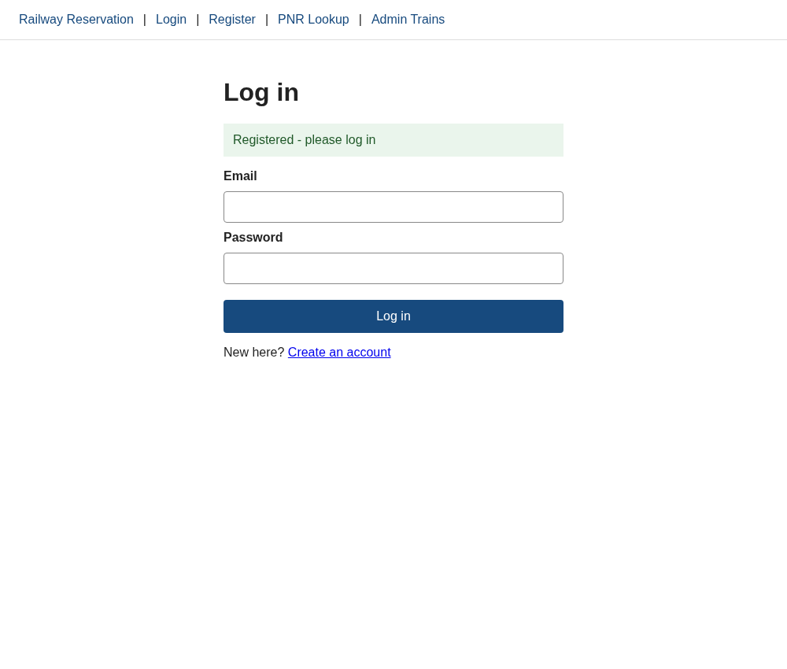
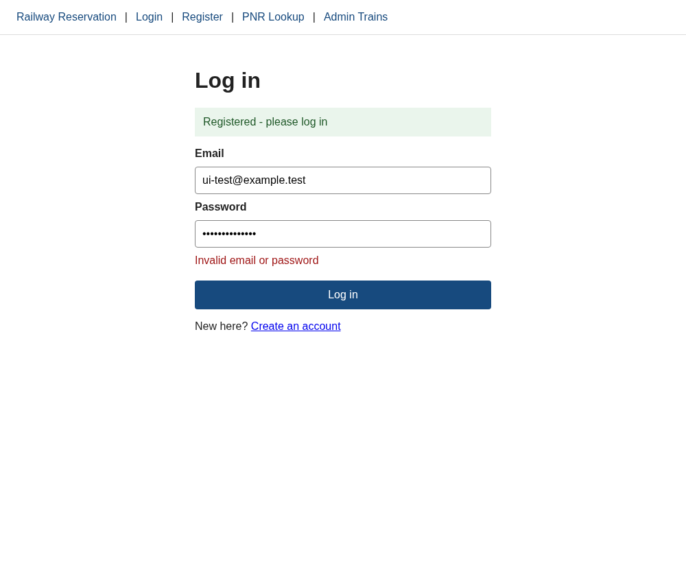
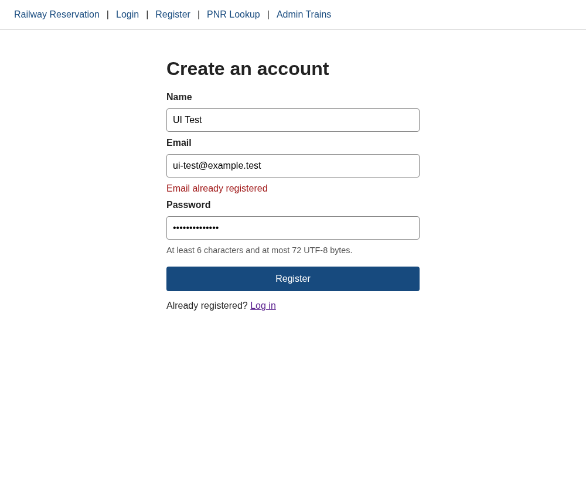

# UI-AUTH walkthrough

Tested against a disposable SQLite database and the real backend using Chrome. No production account or data was used.

| Check | Observed result |
| --- | --- |
| Register with name/email/password | Redirects to /login with "Registered - please log in" |
| Log in with that account | Token and user stored; redirects to /search; navigation shows Logout |
| Wrong password | "Invalid email or password" inline; form stays usable |
| Register existing email | "Email already registered" directly below email field |
| Delayed login request | Submit disabled and says "Logging in..." |
| Network unavailable | Inline fetch error; submit becomes usable again |
| Logout | Token removed; /login opens; navigation shows Login/Register |
| 375px mobile viewport | Fields and submit fit without horizontal overflow |
| Console during normal round trip | No JavaScript exceptions or console.error messages |

Screenshots:

Automated API-helper checks: `cd frontend && node --test src/api.test.js`.
These helper tests are separate from the browser walkthrough; they do not replace UI interaction checks. The current CI workflow runs frontend lint/build but does not run Node frontend tests.

No password reset, real email, complete booking, client-side route guard or admin authorization is claimed in this UI ticket.
